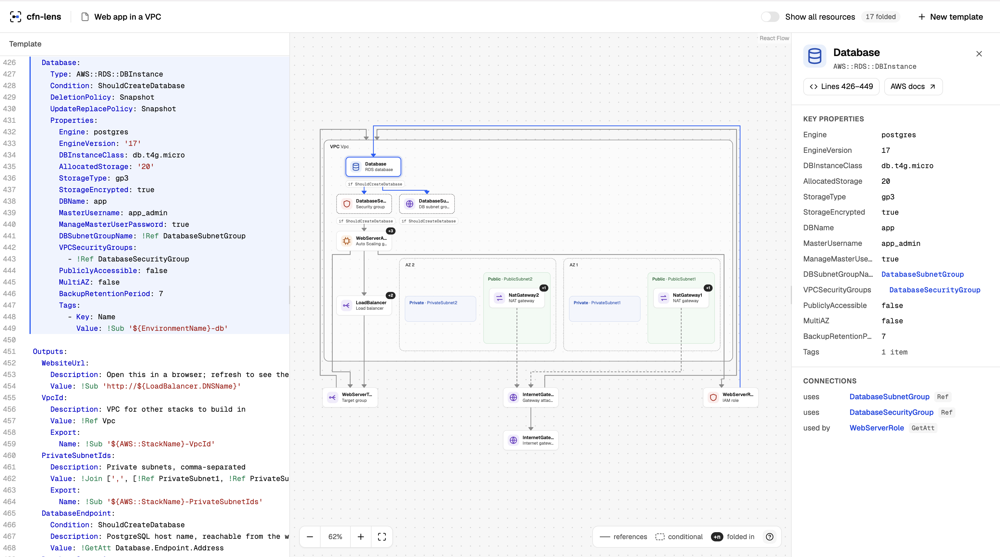

# cfn-lens

**See what your CloudFormation template builds.**

cfn-lens turns AWS CloudFormation templates into interactive architecture diagrams. Paste YAML or JSON, explore how resources connect, and click any resource to understand what it does and find its definition in the source.

Built for people learning AWS—and anyone who wants to make sense of an unfamiliar template faster.

**[Try cfn-lens live →](https://d19rcq58bf5rgp.cloudfront.net/)**



_Explore an architecture, select a resource, and trace it back to the template—all in one workspace._

## Why cfn-lens?

A template describes infrastructure one resource at a time. Understanding the architecture means piecing together references, network placement, permissions, and dependencies across the file.

cfn-lens brings those pieces into one view. See the structure first, then explore the details at your own pace. Use it to learn common AWS patterns, walk through a template with a teammate, or orient yourself before making a change.

## Features

- **Architecture you can explore.** Pan, zoom, and select resources to follow their connections across the diagram.
- **Network context at a glance.** Resources are grouped by VPC, Availability Zone, and subnet, with visual cues for public, private, and unresolved routing.
- **Less clutter, more clarity.** Supporting policies, routes, and attachments fold into the resources they serve. Turn on **Show all resources** when you want the full picture.
- **Plain-English explanations.** Inspect resource descriptions, key properties, connections, and links to AWS documentation.
- **A direct path back to the code.** Jump from resource details to the exact template lines that define them.
- **An editable workspace.** Change the template alongside the diagram and use source-linked diagnostics to investigate problems.
- **YAML and JSON support.** Read CloudFormation templates, including YAML short-form intrinsic tags and relationships expressed through `Ref`, `Fn::GetAtt`, `Fn::Sub`, and `DependsOn`.
- **Conditions stay visible.** Conditional resources and relationships carry visual cues; unresolved placement is surfaced for inspection.
- **Your template stays in your browser.** Template processing runs locally, with no upload, AWS credentials, or login required.

## Try an architecture in seconds

1. Open the application and paste a CloudFormation template, or choose a built-in example.
2. Explore the generated diagram and select a resource to see its purpose, properties, and connections.
3. Jump to its source, edit the template, and watch the diagram update.

The sample gallery includes four starting points:

| Example          | Explore                                                                              |
| ---------------- | ------------------------------------------------------------------------------------ |
| Web app in a VPC | A load balancer and servers across two Availability Zones, with an optional database |
| Serverless API   | API Gateway, Lambda, and DynamoDB                                                    |
| Static website   | A private S3 bucket served through CloudFront with origin access control             |
| Queue worker     | An SQS queue, a Lambda worker, and a dead-letter queue                               |

## Reading the diagram

Boxes represent resources; surrounding areas show network placement. Arrows point from a resource to the resource it references, while dashed dependency arrows indicate deployment order. Fold badges reveal supporting resources tucked into a node.

cfn-lens explains the template rather than deploying it or inspecting a live AWS account. Reference arrows describe relationships, not traffic flow. Conditions and values that cannot be resolved from the template remain explicit, and unfamiliar resource types are still shown.

## Run locally

Requires **Node.js 24 or later** and **pnpm 11.5.1 or compatible**.

```sh
pnpm install
pnpm dev
```

Open the local URL printed by the development server.

```sh
pnpm build        # Build the application and core package
pnpm test         # Run tests
pnpm lint         # Check code quality
pnpm typecheck    # Check TypeScript types
```

## Built with

React and TypeScript power the interface, with Vite for development and builds. The workspace separates the web application in `apps/web` from the template analysis core in `packages/core`. AWS hosting infrastructure is defined in `infra/hosting.yaml`, with deployment through GitHub Actions.
